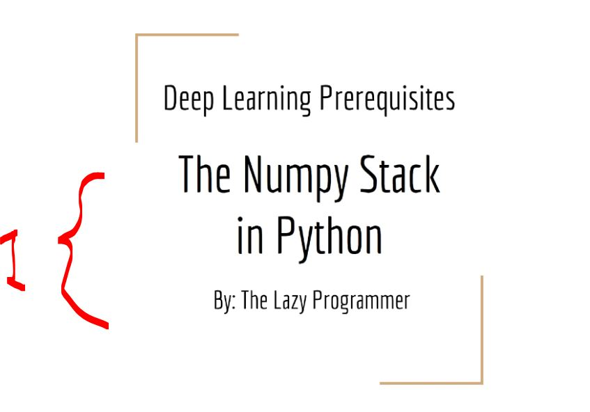
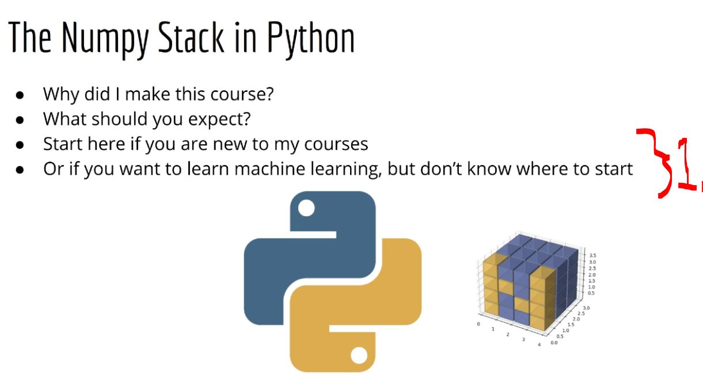
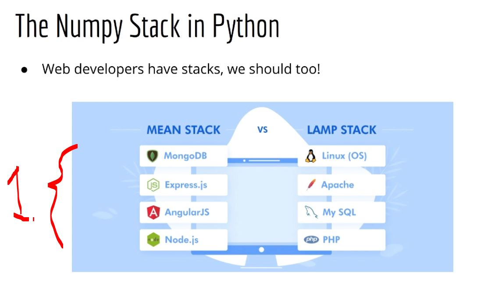
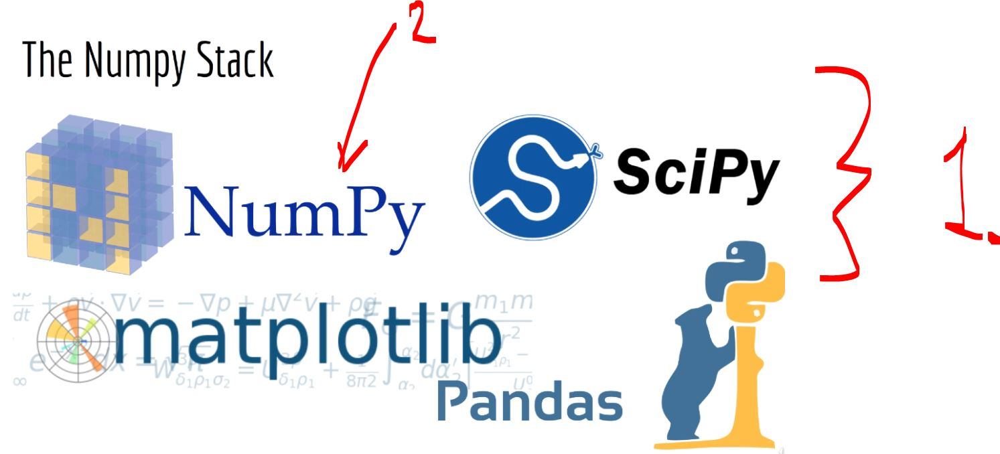
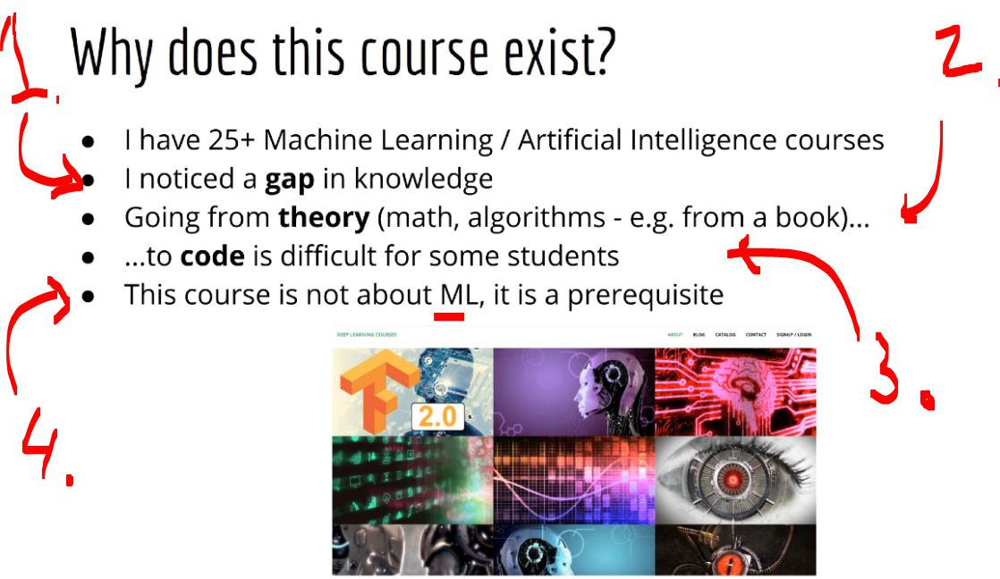
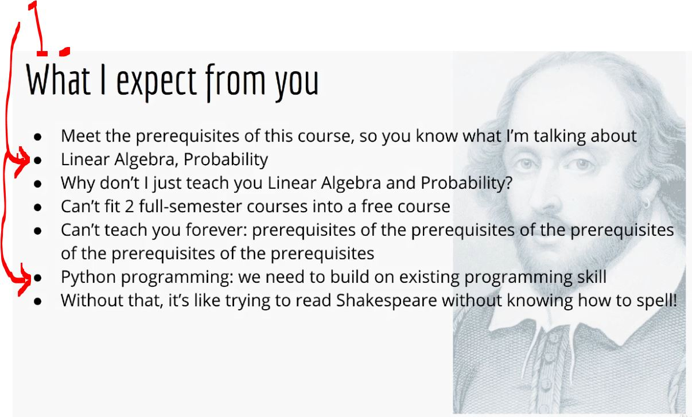
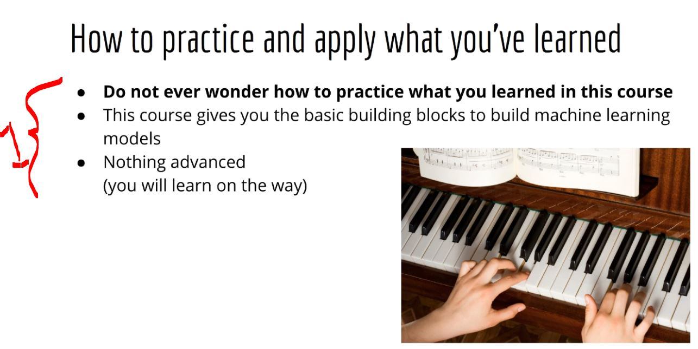
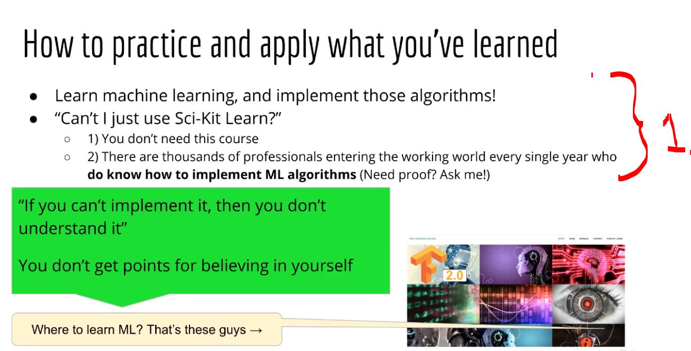
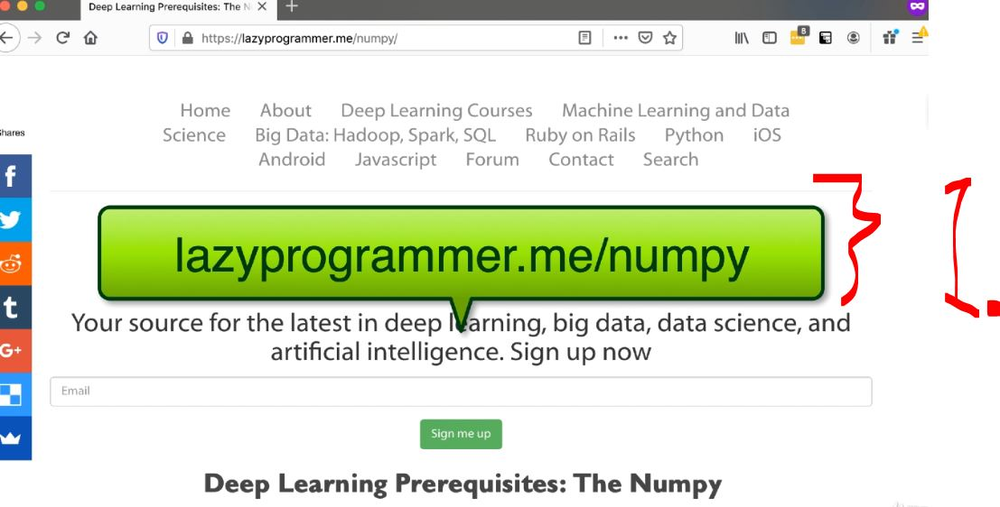

# Section 01: Welcome and Logistics.

 Welcome and Logistics.

# What I Learned.

# Introduction and Outline.

<div align="center">
    
</div>

1. **Numpy** Stack!

<div align="center">
    
</div>

1. This is the place to start from for the **machine learning**!

<div align="center">
    
</div>

1. `Numpy` **stack** for the **Data Scientist** to do the **data magic**!

<div align="center">
    
</div>

1. These are the core technologies!

<div align="center">
    
</div>

1. Many people have **gap** between **theory** and **code**, when building **machine learning models**!
2. Students may **theory knowledge**! 
3. Students have problem to put the **math** into **machine learning code**!
4. This course is not about **ML**!
    - This course is to make up to the **ML**!

<div align="center">
    
</div>

1. What are the **prerequisites**:
    - Some Linear Algebra!
    - Some Probability!
    - Some Python!

<div align="center">
    
</div>

1. In this course you will be learning the **most basics blocs!**

> [!TIP]
> 💡 To learn **algorithms**, one should be **implemented** the **ML algorithm** oneself! 💡

<div align="center">
    
</div>

1. One should be **implemented machine learning algorithm**!

# Quiz 01: What will you learn in this course?

<details>

<summary id="Question_01" open="true"> <b>Question 01.</b> </summary>

````Yaml
Question 01:
What will you learn in this course?
````
- My answer:

<div align="center">
    
</div>

1. This will be for the **fundamentals**!

</details>

# Quiz 02: What level of machine learning is taught in this course?

<details>

<summary id="Question_02" open="true"> <b>Question 02.</b> </summary>

````Yaml
Question 01:
What level of machine learning is taught in this course?
````
- My answer:

<div align="center">
    
</div>

1. There is no **ML** in this course!

</details>

# Quiz 03: How will you practice what you learned in this course?

<details>

<summary id="Question_03" open="true"> <b>Question 03.</b> </summary>

````Yaml
Question 01:
How will you practice what you learned in this course?
````
- My answer:

<div align="center">
    
</div>

1. One should be implementing the own **ML** algorithm!

</details>

# Extra Resources.

- We will be going into the extra material!

<div align="center">
    
</div>

Deep Learning Prerequisites: The Numpy Stack in Python (V2+)
<br>

<div align="center">
    
</div>

1. We can see the **more information** can be found from address `https://lazyprogrammer.me/numpy/`!
    - We can set different information!

<div align="center">
    
</div>

1. We will use **Anaconda**!

