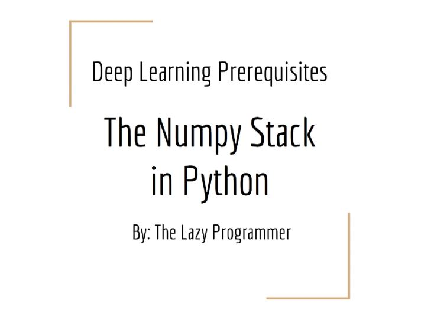

# Section 02: Numpy (New).

Numpy (New).

# What I Learned.

    

# Numpy Section Introduction.

# Arrays vs Lists.

# Dot Product.

# Speed Test.

# Matrices.

# Solving Linear Systems.

# Generating Data.

# Numpy Exercise.

# Where to Learn More Numpy.

# Suggestion Box.