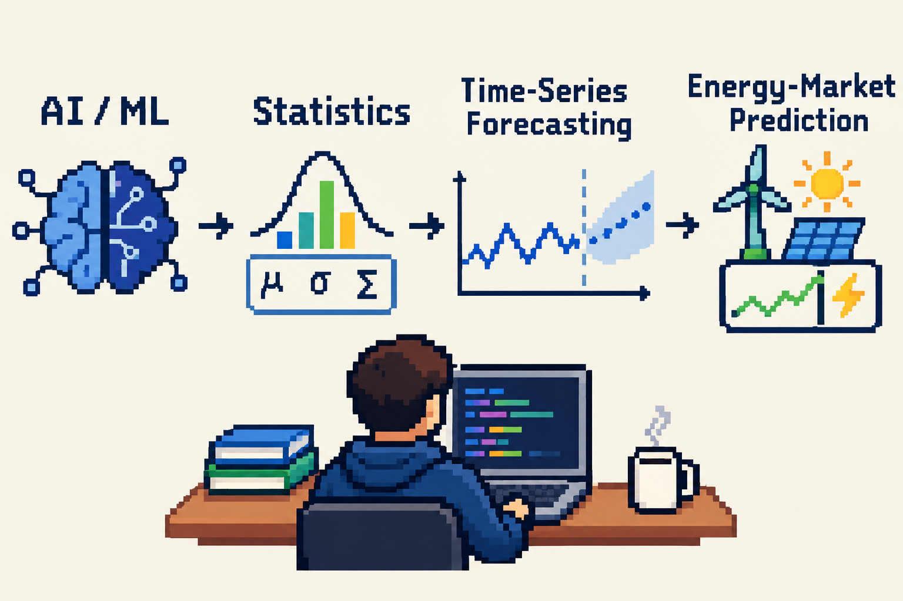
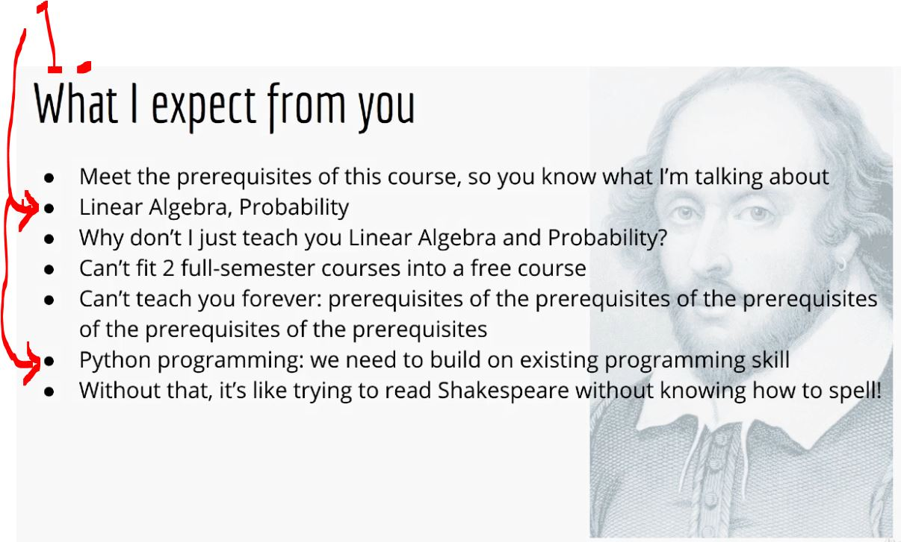
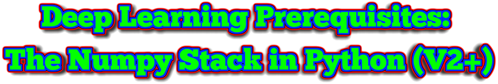
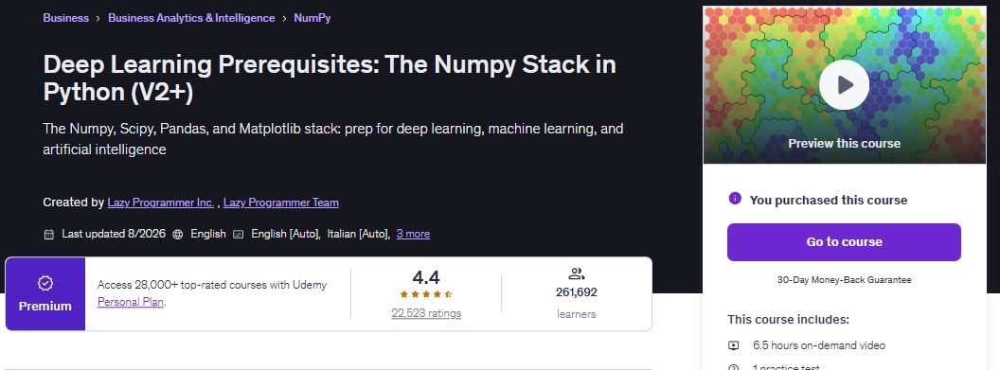
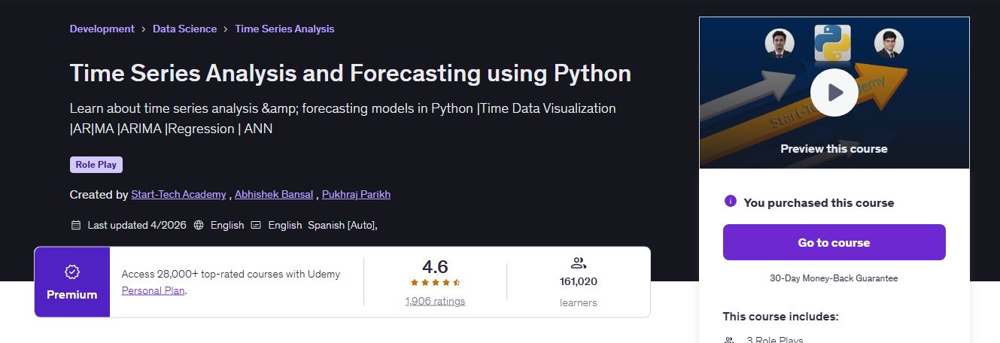

<p align="center">
    
</p>

<p align="center">
    <b>AI/ML</b>, <b>statistics</b>, <b>time-series forecasting</b>, and <b>energy-market prediction</b>.
</p>

<p align="center">
   
</p>

- For these courses one should configure **GIT** for handle projects.
    - `git config --global http.postBuffer 524288000`.
    - `git config --global core.longpaths true`.

<!-- 

We are using following structure:

<p align="center">
    
</p> 
<p align="center">
    
</p>

-->


<!--
Template for the questions:

# Quiz 07: Atomic Operations, Volatile & Metrics Practical Example.

<details>
<summary id="Question_01" open="true"> <b>Question 01.</b> </summary>
````yaml
Question 01:
The question comes here!

- My answer:

<div align="center">
    
</div>

1. Add here the answer!

</details>
-->

<!-- 
Template for the task/exercies:
 
# Lab Exercise - Mapping Collections of Value Types.

<div align="center">
    
</div>

1. **Question 1:** add here the question from the test!
	- **Answer:** **D**. here can be the examplaniton!
 -->
<details>

<summary 
id="Reactive_Course_Series_Summary?trk=public_profile_see-credential"
open="true"
alt="Reactive course series!">
<b> Prerequisites for this course! </b> </summary>

<br>

<p align="center">
    
</p>

1. Add here the description and links!

<!-- 
1. 🎓 Course in Udemy: **Complete Java Reactive Programming** 🎓: The [Course](https://www.udemy.com/course/complete-java-reactive-programming/)!
     - ✍🏻 Course in learning diary: **Complete Java Reactive Programming** ✍🏻: [Learning Diary](https://github.com/developersCradle/reactive-programming#Mastering_Java_Reactive_Programming_From%20Scratch_Caption?trk=public_profile_see-credential)!
2. 🎓 Course in Udemy: **Spring WebFlux Masterclass: Reactive Microservices [New]** 🎓: The [Course](https://www.udemy.com/course/spring-webflux/)!
    - ✍🏻 Course in learning diary: **Spring WebFlux Masterclass: Reactive Microservices [New]** ✍🏻: [Learning Diary](https://github.com/developersCradle/reactive-programming#Spring_WebFlux_Masterclass_High_Performance_Reactive_APIs_Caption?trk=public_profile_see-credential)!
-->

</details>

<p align="center">
    
</p> 

<p align="center">
    
</p>

All course material from *Deep Learning Prerequisites: The Numpy Stack in Python (V2+)* from **Lazy Programmer Inc**.

> Data is the **cornerstone**. 🧩
>
> Before building intelligent models, you need to understand the data behind them—how to manipulate it, visualize it, analyze it, and uncover the patterns hidden within.
>
> That led me back to the fundamentals of the Python data science ecosystem: NumPy, Pandas, Matplotlib, and SciPy. 🐍
>
> By the end, it wasn’t simply about learning new libraries. It was about strengthening the foundation that supports everything that comes next—from statistical analysis to Machine Learning and eventually Deep Learning.
>
> Because powerful models don’t start with complex algorithms.
>
> **They start with good data, strong fundamentals, and the ability to understand what the data is telling you.** 📊
>
> One layer at a time. One dataset at a time. One insight at a time. 🐟 <br><br> ~ *DevelopersCradle*

Contains my own visual notes ✍️ with some course material to enforce learning experience.

This repository is made with [](#) with [](#) hotkeys, therefore it will include configuration files which are related to this IDE this approach will be favored for now. ⚙️

[The course at Udemy](https://www.udemy.com/course/deep-learning-prerequisites-the-numpy-stack-in-python/). 

[Website of maker](https://lazyprogrammer.me/).

If the content sparked 🔥 your interest, please consider buying the course and start learning 📖.

<!-- 
Linkedin puts this shit front, when clicking from private mode x(. Need to put this to make jump working every case
?trk=public_profile_see-credential 
-->

<div align="center">
    Insert certificate here when completed
</div>

**Note: The material provided in this repository is only for helping those who may get stuck at any point of time in the course. It is very advised that no one should just copy the solutions(violation of Honor Code) presented here.**

#### Progress/Curriculum.

- [ ] [Section 01](https://github.com/developersCradle/applied-ai-ml-statistical-forecasting/tree/main/Deep%20Learning%20Prerequisites%20The%20Numpy%20Stack%20in%20Python%20V2/Section%2001#section-01-welcome-and-logistics) - Welcome and Logistics.
- [ ] [Section 02](https://github.com/developersCradle/applied-ai-ml-statistical-forecasting/tree/main/Deep%20Learning%20Prerequisites%20The%20Numpy%20Stack%20in%20Python%20V2/Section%2002#section-02-numpy-new) - Numpy (New).
- [ ] [Section 03](https://github.com/developersCradle/applied-ai-ml-statistical-forecasting/tree/main/Deep%20Learning%20Prerequisites%20The%20Numpy%20Stack%20in%20Python%20V2/Section%2003#section-03-matplotlib-new) - Matplotlib (New).
- [ ] [Section 04](https://github.com/developersCradle/applied-ai-ml-statistical-forecasting/tree/main/Deep%20Learning%20Prerequisites%20The%20Numpy%20Stack%20in%20Python%20V2/Section%2004#section-04-pandas-new) - Pandas (New).
- [ ] [Section 05](https://github.com/developersCradle/applied-ai-ml-statistical-forecasting/tree/main/Deep%20Learning%20Prerequisites%20The%20Numpy%20Stack%20in%20Python%20V2/Section%2005#section-05-scipy-new) - Scipy (New).
- [ ] [Section 06](https://github.com/developersCradle/applied-ai-ml-statistical-forecasting/blob/main/Deep%20Learning%20Prerequisites%20The%20Numpy%20Stack%20in%20Python%20V2/Section%2006/README.md#section-06-bonus-exercises) - Bonus Exercises.
- [ ] [Section 07](https://github.com/developersCradle/applied-ai-ml-statistical-forecasting/tree/main/Deep%20Learning%20Prerequisites%20The%20Numpy%20Stack%20in%20Python%20V2/Section%2007#section-07-beginner-troubleshooting) - Beginner Troubleshooting.
- [ ] [Section 08](https://github.com/developersCradle/applied-ai-ml-statistical-forecasting/blob/main/Deep%20Learning%20Prerequisites%20The%20Numpy%20Stack%20in%20Python%20V2/Section%2008/README.md#section-08-machine-learning-basics) - Machine Learning Basics.
- [ ] [Section 09](https://github.com/developersCradle/applied-ai-ml-statistical-forecasting/tree/main/Deep%20Learning%20Prerequisites%20The%20Numpy%20Stack%20in%20Python%20V2/Section%2009#section-09-quizzes) - Quizzes.
- [ ] [Section 10](https://github.com/developersCradle/applied-ai-ml-statistical-forecasting/tree/main/Deep%20Learning%20Prerequisites%20The%20Numpy%20Stack%20in%20Python%20V2/Section%2010#section-10-appendix--faq-intro) - Appendix / FAQ Intro.
- [ ] [Section 11](https://github.com/developersCradle/applied-ai-ml-statistical-forecasting/blob/main/Deep%20Learning%20Prerequisites%20The%20Numpy%20Stack%20in%20Python%20V2/Section%2011/README.md#section-10-appendix--faq-intro) - Setting Up Your Environment (FAQ by Student Request).
- [ ] [Section 12](#) - Extra Help With Python Coding for Beginners (FAQ by Student Request).
- [ ] [Section 13](#) - Effective Learning Strategies for Machine Learning (FAQ by Student Request).
- [ ] [Section 14](#) - Appendix / FAQ Finale.

#### Additional stuff.
- Add enter spacing!
- [ ] Add here!

#### The Quizzes and Labs.

* **Section 01**:
    * *Quiz*:
        * [Quiz 01](https://github.com/developersCradle/applied-ai-ml-statistical-forecasting/tree/main/Deep%20Learning%20Prerequisites%20The%20Numpy%20Stack%20in%20Python%20V2/Section%2001#quiz-01-what-will-you-learn-in-this-course) - What will you learn in this course?
        * [Quiz 02](https://github.com/developersCradle/applied-ai-ml-statistical-forecasting/tree/main/Deep%20Learning%20Prerequisites%20The%20Numpy%20Stack%20in%20Python%20V2/Section%2001#quiz-02-what-level-of-machine-learning-is-taught-in-this-course) - What level of machine learning is taught in this course?
        * [Quiz 03](https://github.com/developersCradle/applied-ai-ml-statistical-forecasting/tree/main/Deep%20Learning%20Prerequisites%20The%20Numpy%20Stack%20in%20Python%20V2/Section%2001#quiz-03-how-will-you-practice-what-you-learned-in-this-course) - How will you practice what you learned in this course?

<p 
align="center">
    
</p> 

<p align="center">
    
</p>

All course material from *Time Series Analysis and Forecasting using Python* from **Start-Tech Academy**, **Abhishek Bansal** and **Pukhraj Parikh**.

> add here. 🐟 <br><br> ~ *DevelopersCradle*

Contains my own visual notes ✍️ with some course material to enforce learning experience.

This repository is made with [](#) with [](#) hotkeys, therefore it will include configuration files which are related to this IDE this approach will be favored for now. ⚙️

[The course at Udemy](https://www.udemy.com/course/machine-learning-time-series-forecasting-in-python). 

[Website of maker](https://starttechacademy.com/).

If the content sparked 🔥 your interest, please consider buying the course and start learning 📖.

<!-- 
Linkedin puts this shit front, when clicking from private mode x(. Need to put this to make jump working every case
?trk=public_profile_see-credential 
-->

<p 
id="Logo_Combination" 
align="center">
    
    
</p>


**Note: The material provided in this repository is only for helping those who may get stuck at any point of time in the course. It is very advised that no one should just copy the solutions(violation of Honor Code) presented here.**

#### Progress/Curriculum.

- [ ] [Section 01](#) - Introduction. ✅
- [ ] [Section 02](#) - Time Series - Basics.
- [ ] [Section 03](#) - Setting up Python and Python Crash Course.
- [ ] [Section 04](#) - Time Series - Data Loading.
- [ ] [Section 05](#) - Time Series - Feature Engineering.
- [ ] [Section 06](#) - Time Series - Resampling.
- [ ] [Section 07](#) - Time Series - Visualization.
- [ ] [Section 08](#) - Time Series - Transformation.
- [ ] [Section 09](#) - Time Series - Important Concepts.
- [ ] [Section 10](#) - Time Series - Test Train Split.
- [ ] [Section 11](#) - Time Series - Naive (Persistence) model.
- [ ] [Section 12](#) - Time Series - Auto Regression Model.
- [ ] [Section 13](#) - Time Series - Moving Average model.
- [ ] [Section 14](#) - Time Series - ARIMA model.
- [ ] [Section 15](#) - Time Series - SARIMA model.
- [ ] [Section 16](#) - Stationary time Series
- [ ] [Section 17](#) - Linear Regression - Data Preprocessing.
- [ ] [Section 18](#) - Linear Regression - Model Creation.
- [ ] [Section 19](#) - Introduction to ANN.
- [ ] [Section 20](#) - Single Cells - Perceptron and Sigmoid Neuron.
- [ ] [Section 21](#) - Neural Networks - Stacking cells to create network.
- [ ] [Section 22](#) - Important concepts: Common Interview questions.
- [ ] [Section 23](#) - Standard Model Parameters.

#### Additional stuff.

- [ ] Do the [Kaggle](https://www.kaggle.com/learn/time-series)!
- At end of the course check if the `Data + Code` is needed!

- Check [Forecasting: Principles and Practice](https://otexts.com/fpp3/)!

#### The Quizzes and Coding Exercise.

* **Section 01** - Introduction.
    * *Quiz*:
        * [Quiz 01](#). ✅
* **Section 02** - Time Series - Basics.
    * *Quiz*:
        * [Quiz 02](#).
* **Section 03** - Setting up Python and Python Crash Course.
    * *Quiz*:
        * [Quiz 03](#).
    * *Coding Exercise*:
        * [Coding Exercise xx: add here](#).
        * [Coding Exercise xx: add here](#).
        * [Coding Exercise xx: add here](#).
        * [Coding Exercise xx: add here](#).
        * [Coding Exercise xx: add here](#).
* **Section 05** - Time Series - Feature Engineering.
    * *Quiz*:
        * [Quiz 04](#).
* **Section 06** - Time Series - Resampling.
    * *Quiz*:
        * [Quiz 05](#).
* **Section 17** - Linear Regression - Data Preprocessing.
    * *Quiz*:
        * [Quiz 06](#).
* **Section 20** - Single Cells - Perceptron and Sigmoid Neuron.
    * *Quiz*:
        * [Quiz 07](#).
* **Section 21** - Neural Networks - Stacking cells to create network.
    * *Quiz*:
        * [Quiz 08](#).
* **Section 23** - Standard Model Parameters.
    * *Quiz*:
        * [Quiz 09](#).


        


