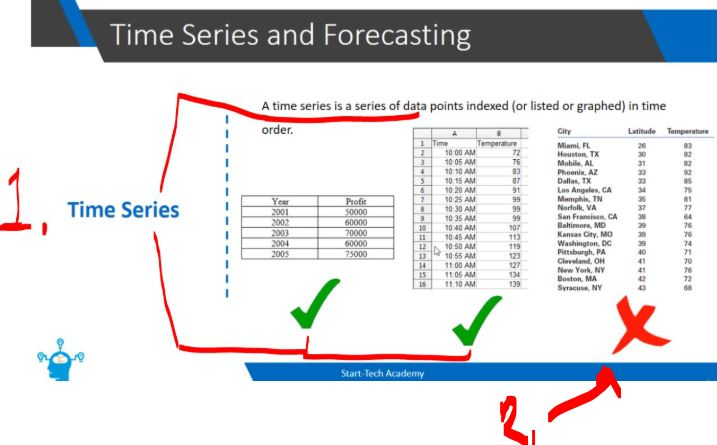
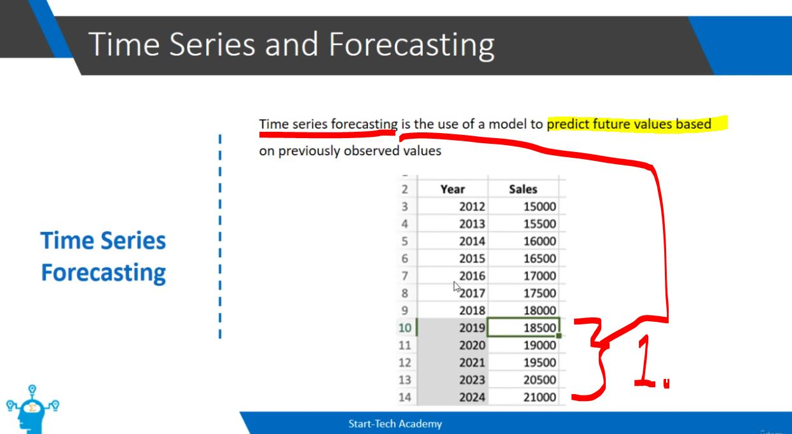

# Section 01: Introduction. ✅

Introduction.

# What I Learned.

# Welcome to the course. ✅

- Todo

# What is Time Series Forecasting? ✅

> [!NOTE]
> 📝 **Cross-sectional data** is data collected from multiple individuals, objects, groups, or entities at a **single point in time** or over a short period of time. 📝

    

1. Time series is sequence of **data** with recorded **time**!
2. This is **cross-sectional data**, It's either collected **one period** of time, or there is **no time period** of data!

    

1. We can use **Time series forecasting** to predict the **lower sales**!
    - This can use the **model**, here we are using **Simple Linear Regression**!
        - There are **different models** to make these predictions.

- Some examole of the models in **Forecasting**:

| Model | Main idea |
|---|---|
| **Naive model** | Predicts the next value using the latest observed value. |
| **Moving average** | Uses the average of recent observations to predict future values. |
| **Linear regression** | Learns the relationship between time-related features and the target variable. |
| **ARIMA** | Models temporal dependencies and patterns in a time series. |
| **Machine learning models** | Uses algorithms such as XGBoost or Random Forest with time-based features. |
| **Deep learning models** | Uses neural networks to learn complex patterns from sequences of data. |

# Course Resources. ✅

- The content of the course here!

# This is a Milestone! ✅

- Cool information here.

# Quiz 01: Quiz.

 <b>Question 01.</b> 

    

- My answer:

    

1. Time series is sequence of **data** with recorded **time**!

 <b>Question 02.</b> 

    

- My answer:

    

1. **Cross-sectional data**, It's either collected **one period** of time, or there is **no time period** of data!

 <b>Question 03.</b> 

    

- My answer:

    

1. **Time series forecasting** is the process of using historical data collected over time **to predict future values** of a variable.

