# Time Series - Basics. ✅

Time Series - Basics.

# What I Learned.

# Time Series Forecasting - Use cases. ✅

- Time Series is performed in where there is with the quantitive data! 

    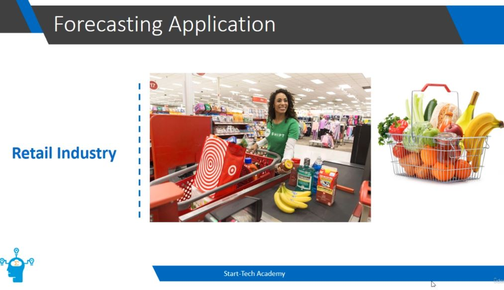

1. In **Retail Industry** they can use also use forecasting!
    - Sales forecast!

    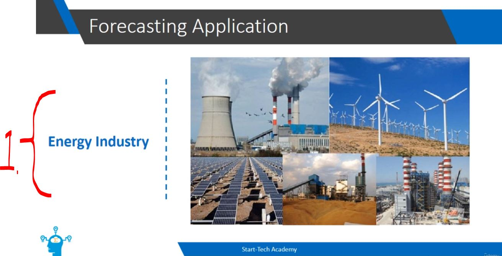

1. Used in **Energy sector**!
    - **Demand forecast** used for short term production planning and prizing!

    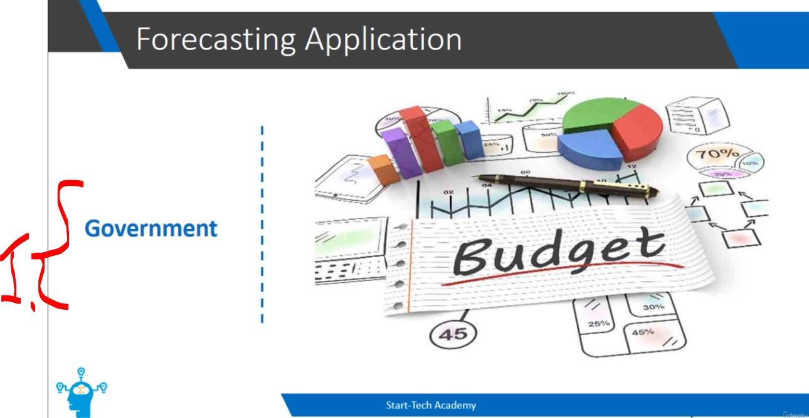

1. **Governments** are using forecasts for budgets!

    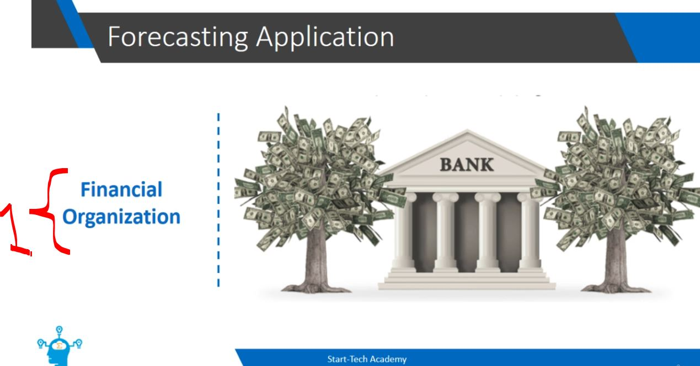

1. **Banks** forecast new home purchases!

    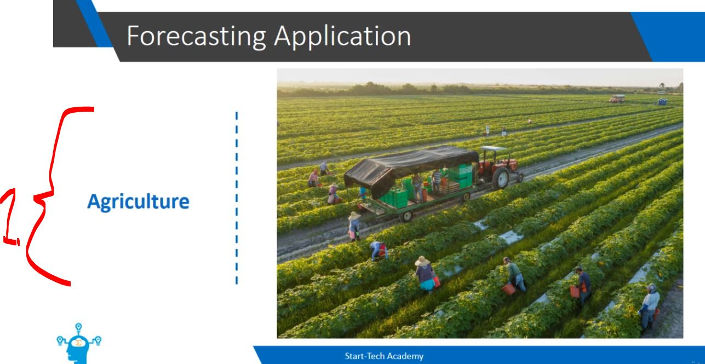

1. **Agriculture** forecast for weather!

# Forecasting model creation - Steps. ✅

    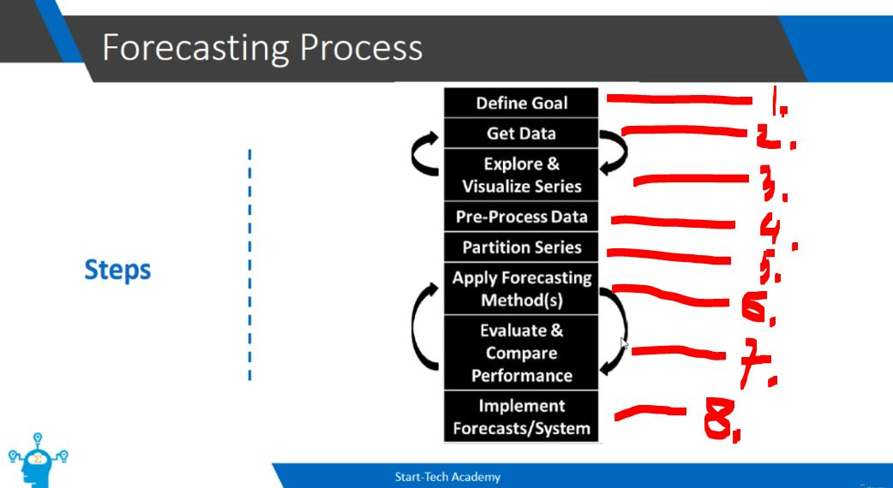

1. Define **Goal Establish** what needs to be predicted, the required accuracy level, and how the forecasts will be used to make business or **operational decisions**.
2. **Data Collect** historical time series data from relevant databases, APIs, or files.
    - **Most of the time** will be used here to set the data ready! 
3. Explore & Visualize Series Plot the time series to identify patterns such as trends, seasonality, cycles, or outliers. Note: The feedback loop indicates you may need to acquire additional or cleaner data based on initial visualizations.   
4. Pre-Process Data Handle missing values, smooth out noise, transform variables (e.g., log transformations), or handle stationary (e.g., differencing).
5. Partition Series Split the dataset into training, validation, and test sets to ensure model evaluation is unbiased.
6. **Apply Forecasting Method(s)** Fit candidate models to the training data (e.g., ARIMA, Exponential Smoothing, Prophet, or Linear Regression).
7. Evaluate & Compare Performance Assess model accuracy using metrics such as MAE, RMSE, or MAPE on validation sets. Note: The feedback loop indicates that evaluation results often require tuning model hyperparameters or testing alternative algorithms.   
8. Implement Forecasts/System Deploy the selected model into production to generate regular automated forecasts for decision-making.

- Forecast accuracy is improved over time!

# Forecasting model creation - Steps 1 (Goal). ✅

- We should be clear about the goal!

    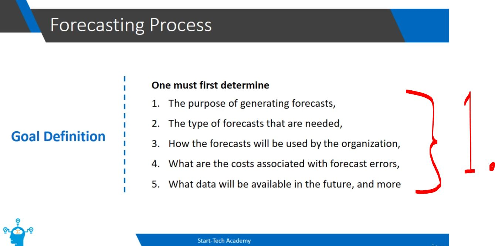

- Forecasting Process - One must first determine:
    - `1.` The **purpose** of generating forecasts.
    - `2.` The **type** of forecasts that are needed.
    - `3.` How the **forecasts will be used** by the organization.
    - `4.` What are the **costs** associated with forecast errors.
    - `5.` What **data will be available** in the future, and more.

    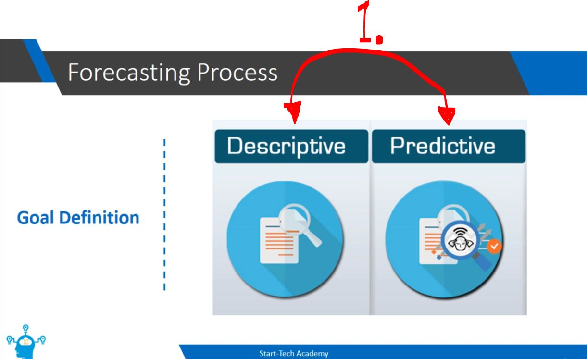

1. Is our goal
    - Descriptive analysis!
        - Focuses on understanding historical data to summarize what has happened in the **past**.
    - Predictive analysis!
        - Uses historical data and statistical models to **forecast** what is likely to happen in the **future**.

    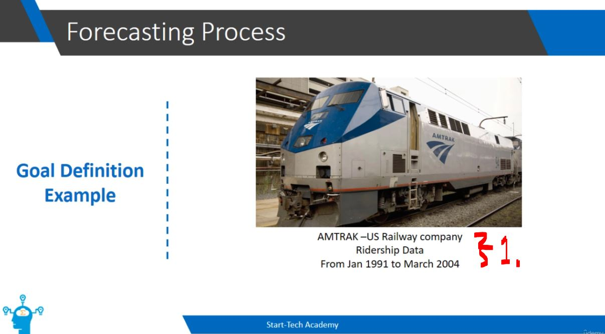

1. We will use the data from this **period**!

    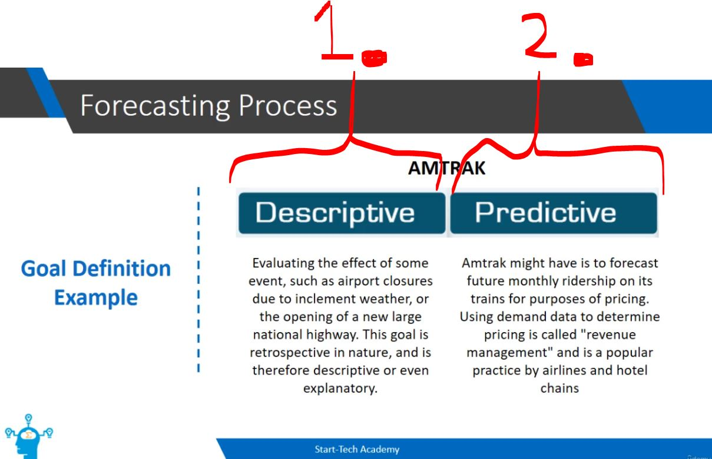

1. **Descriptive** goal:
    - Is to **look back** as (retrospective)!
        - Evaluating the effect of some event, such as airport closures due to inclement weather, or the opening of a new large national highway. This goal is retrospective in nature, and is therefore descriptive or even explanatory.
            - If, there is **airport closure** due to inclement weather, what impact it might have!
2. **Predictive** goal:
    - Is to **look forward** and measure the future!
        - **Amtrak** might have is to **forecast future monthly ridership** on its trains for purposes of pricing. Using demand data to determine pricing is called "revenue management" and is a popular practice by airlines and hotel chains.
            - Example. Airlines have higher prices in peak travelling season!

# Time Series - Basic Notations.

    

1. `t=1` denotes time Monday, `t=2` denotes time Tuesday! **Time period**!
2. $y_1, y_2, y_3, \dots, y_n$ Denotes the **value**!
3. Forecasted value $F_t$ for the time period of `t`! 
4. `k`-step-ahead forecast from the time of `t`!
5. $e_t$ Forecast error!

    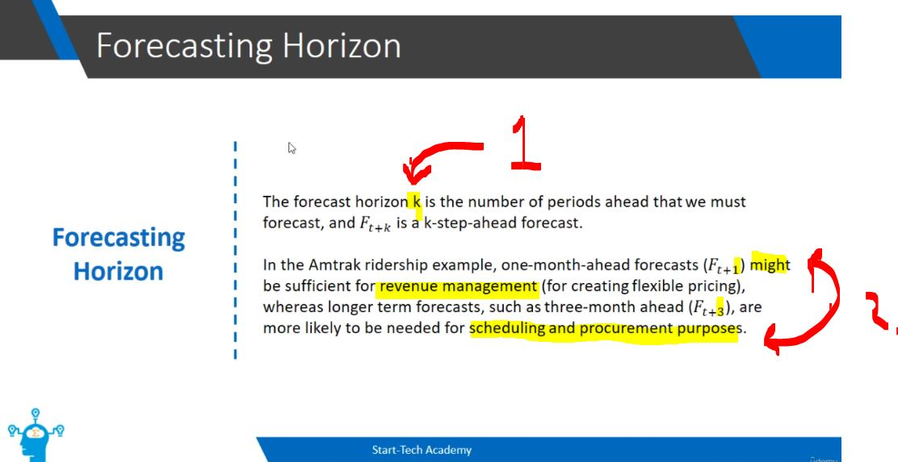

1. If the `k` will be **3**, we will be forecasting for the **3 months**!
2. $F_{t+1}$ for the short **1-month** it would be good for the handing the income flow!
$F_{t+3}$ for the **3-month** managing the **income scheduling**!

> [!NOTE]
> 📖 Following question needs be answered when we are defined goals! 📖 

    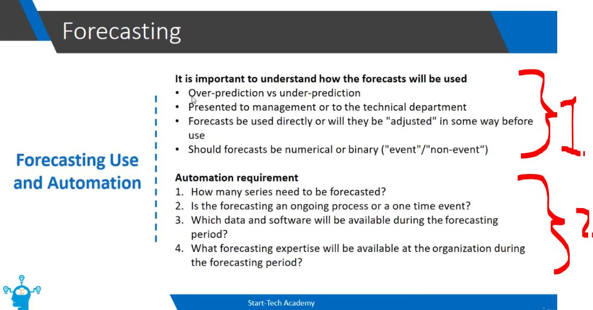

1. Think of the **over-prediction** or **under-prediction**, which would be making huge loss for the business!
What is the type of the forecast **binary forecast** / **numerical forecast**!

2. We can **automate the forecasting**, for example inventory in the end of the month!

# Quiz 02: Quiz. ✅

 <b>Question 01.</b> 

    

- My answer:

    

1. Big organizations forecast, like world bank!

 <b>Question 02.</b> 

    

- My answer:

    

1. First steps of the forecasting are to set the **goal**!

 <b>Question 03.</b> 

    

- My answer:

    

1. The **forecasting process** is iterative!

 <b>Question 04.</b> 

    

- My answer:

    

1. Descriptive analysis helps to analyze the past! There are different models:
    - **black-box** models!
    - **explainable** models!
        - **Focus on underlying patterns and causes:** 
        Descriptive analysis specifically focuses on understanding the underlying patterns and causes of a phenomenon, rather than just predicting future outcomes.
        - **Interpreting insights:**
        Explainable models are ideal for this because they help directly in understanding the patterns and relationships within the data, allowing you to easily interpret those insights.   

