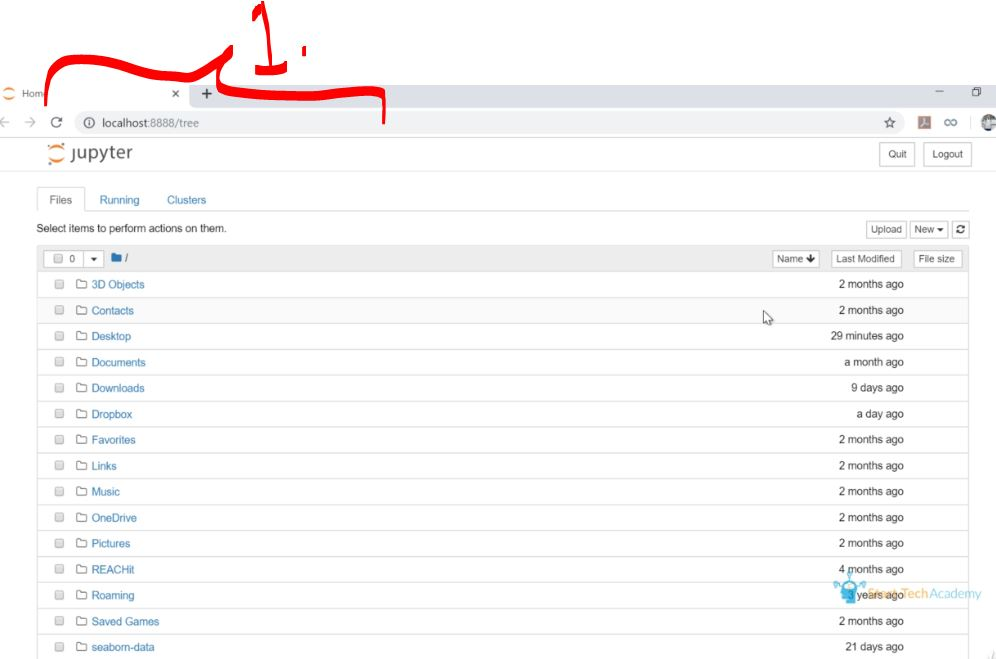
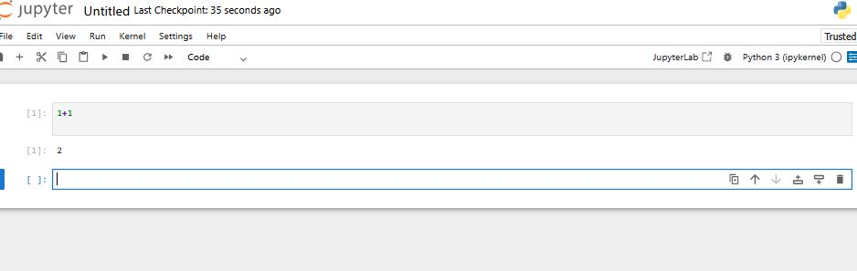
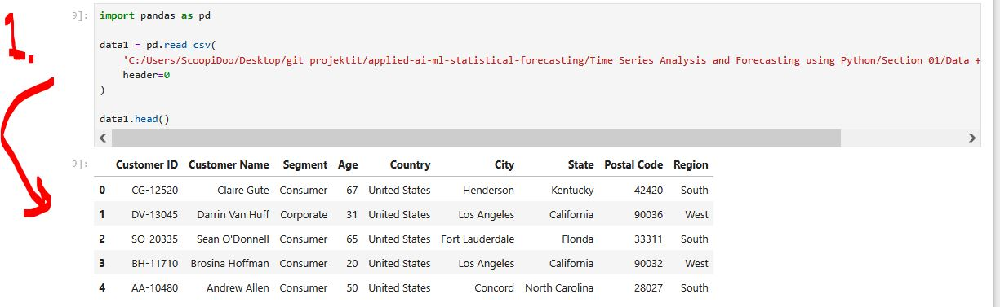

# Section 03 - Setting up Python and Python Crash Course.

Setting up Python and Python Crash Course.

# What I Learned.

# Installing Python and Anaconda.

- Anaconda is full [library](https://www.anaconda.com/download)!
 
# Course resources.

- [Check material](https://github.com/developersCradle/applied-ai-ml-statistical-forecasting/tree/main/Time%20Series%20Analysis%20and%20Forecasting%20using%20Python/Section%2001/Data%20%2B%20Code)!

# Opening Jupyter Notebook.

<div 
align="center">
    
</div>

1. We can see the home screen.

# Introduction to Jupyter.

<div 
align="center">
    
</div>

1. We can see the home screen.

# Arithmetic operators in Python: Python Basics.

- **Addition:** Use + to add numbers (e.g., a + b).
- **Subtraction:** Use - to subtract numbers (e.g., a - b).
- **Multiplication:** Use * for multiplication (e.g., a * b).
- **Division:** Use / for division (e.g., a / b).
- **Exponentiation:** Use ** to raise to a power (e.g., a ** b). 

# Strings in Python: Python Basics.

# Coding Exercise 02: Quick coding exercise on String operations.

# Lists, Tuples and Directories: Python Basics.

# Coding Exercise 03: Quick coding exercise on Tuples.

# Working with Numpy Library of Python.

- We are importing the `.scv` and printing it:

````Python
import pandas as pd

data1 = pd.read_csv(
    'C:/Users/ScoopiDoo/Desktop/git projektit/applied-ai-ml-statistical-forecasting/Time Series Analysis and Forecasting using Python/Section 01/Data + Code/Customer.csv',
    header=0
)

data1.head()
````

- `data1.head()` shows the beginning of your data.

<div 
align="center">
    
</div>

1. We can see the **CSV** into data table!


# Quiz 03: Quiz.

<details>

<summary 
id="Quiz_03_Question_01"
open="true"> <b>Question 01.</b> </summary>

<div align="center">
    
</div>

- My answer:

<div align="center">
    
</div>

1. 

</details>
<details>

<summary 
id="Quiz_03_Question_02"
open="true"> <b>Question 02.</b> </summary>

<div align="center">
    
</div>

- My answer:

<div align="center">
    
</div>

1. 

</details>

<details>

<summary 
id="Quiz_03_Question_03"
open="true"> <b>Question 03.</b> </summary>

<div align="center">
    
</div>

- My answer:

<div align="center">
    
</div>

1.
</details>