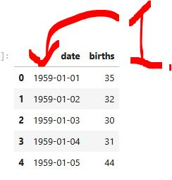
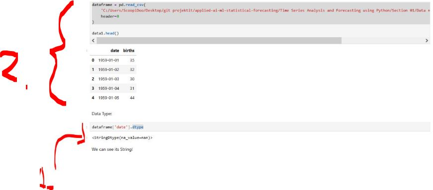
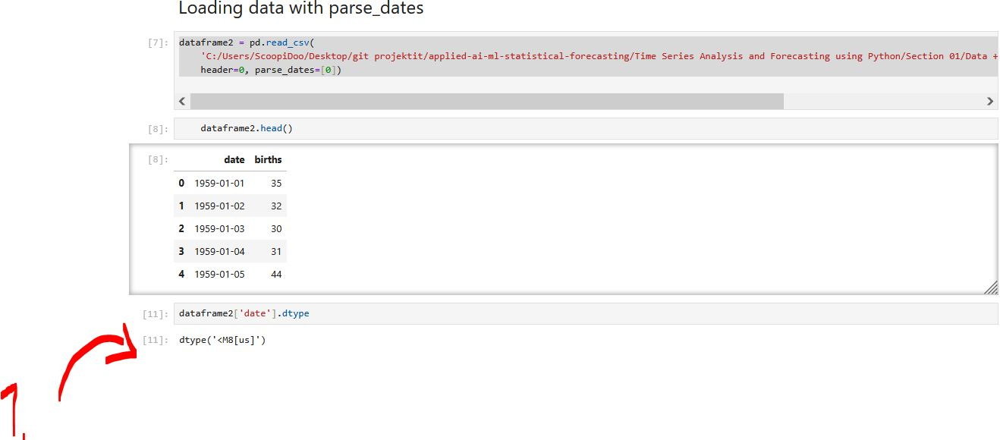
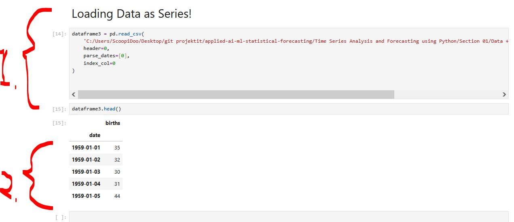

# Section 04: Time Series - Data Loading.

Time Series - Data Loading.

# What I Learned.

# Data Loading in Python.

<div 
align="center">
    
</div>

1. For further data processing we want `date` be in format of date, **not** in the string!

<div 
align="center">
    
</div>

1. `<StringDtype(na_value=nan)>` is related to pandas' string data type in Python!
2. We can load the **data with the parse_date**:
    ````Python
    import pandas as pd

    dataframe = pd.read_csv(
        'C:/Users/ScoopiDoo/Desktop/git projektit/applied-ai-ml-statistical-forecasting/Time Series Analysis and Forecasting using Python/Section 01/Data + Code/daily-total-female-births-CA.csv',
        header=0
    )
    ````


<div 
align="center">
    
</div>

1. `dtype('<M8[us]')` is a NumPy data type representing date time values with microsecond precision.
2. We can load the **data with the parse_date**:
    ````Python
    dataframe2 = pd.read_csv(
        'C:/Users/ScoopiDoo/Desktop/git projektit/applied-ai-ml-statistical-forecasting/Time Series Analysis and Forecasting using Python/Section 01/Data + Code/daily-total-female-births-CA.csv',
        header=0, 
        parse_dates=[0])
    ````

> [!NOTE]
> 📖 **DataFrame** = the entire table. 📖
> 📖 **Series** = one column from that table. 📖
> 📖 **Index** = labels identifying each value (in your case, dates). 📖
> 📖 **Values** = the actual data (in your case, the number of births). 📖

<div 
align="center">
    
</div>

1. We can load the **data as series**, with the following:
    ````Python
    series = pd.read_csv(
    'C:/Users/ScoopiDoo/Desktop/git projektit/applied-ai-ml-statistical-forecasting/Time Series Analysis and Forecasting using Python/Section 01/Data + Code/daily-total-female-births-CA.csv',
    header=0,
    parse_dates=[0],
    index_col=0
    )
    ````

- **Series** is a **single column of data**, while a **DataFrame** is a **table containing rows and columns**.
