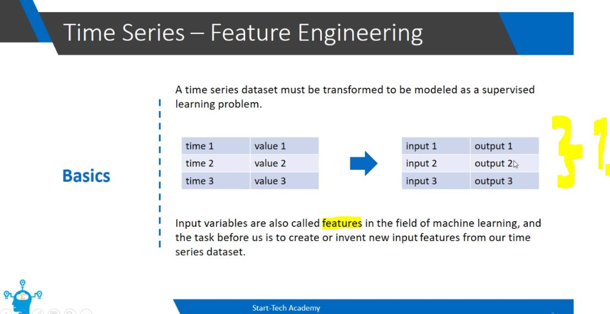
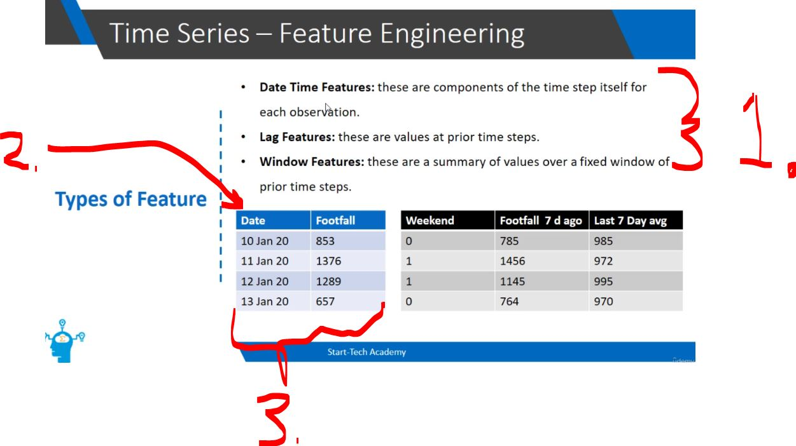
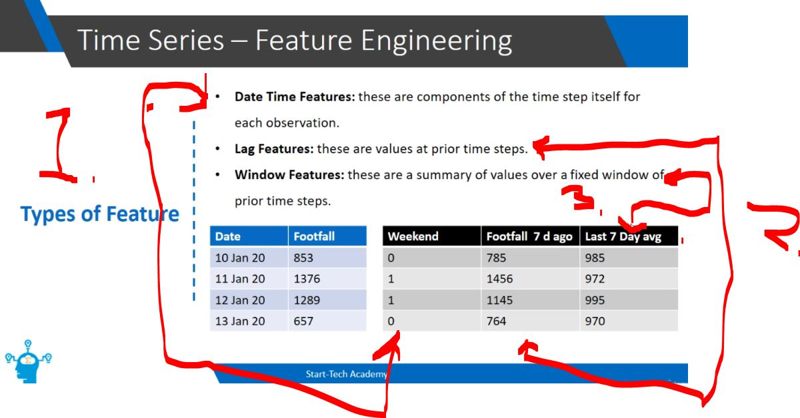
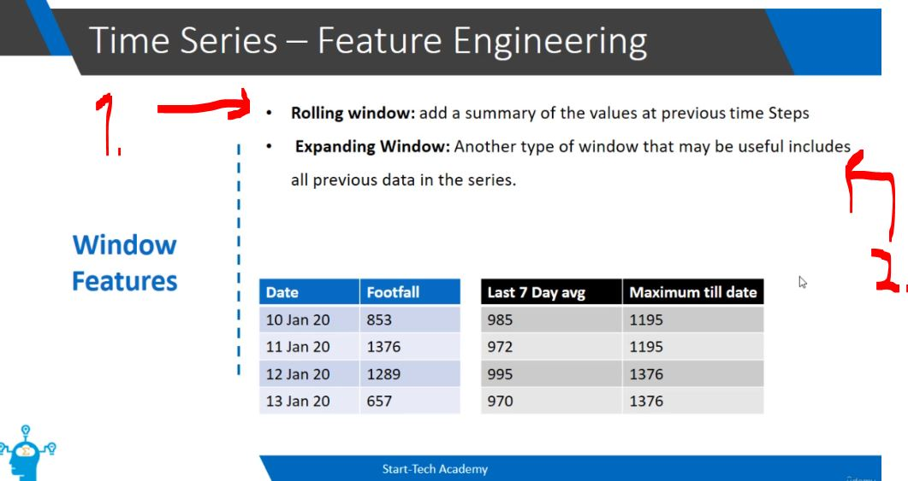

# Section 05: Time Series - Feature Engineering.

Time Series - Feature Engineering.

# What I Learned.
 
# Time Series - Feature Engineering Basics. ✅

    

1. These inputs are called **features**!

> [!TIP]
> 💡 **Feature Engineering** in the context of time series analysis refers to the **process of creating** or **inventing new input variables**! 💡

    

1. We can see the **Feature Engineering** here, we are **producing** the outputs!
    - **Date Time Features**:
        **Definition:** These are **components extracted directly** from the **timestamp or date** of each observation.   
        **Example:** From a date like 11 Jan 20 (which is a Saturday), you can extract a binary Weekend column where 1 indicates a weekend and 0 indicates a weekday. Other examples include extracting the specific hour, day of the week, or month.   
    - **Lag Features**:
        - **Definition:** These are the actual values from **prior time steps**.   
        **Example:** If you want to predict today's store visitors, you can create a feature called Footfall 7 d ago (e.g., using the visitor count from exactly one week prior, like 1456 visitors on a previous Saturday) to help the model capture weekly seasonality.
            - Sometimes it is good to consider **last forecast** features!
    - **Window Features**:
        - **Definition:** These are **summary statistics** (like a rolling average or sum) calculated over a **fixed window of pastime steps**. 
        - **Example:** Creating a feature called Last 7 Day avg, which calculates the moving average of visitor numbers over the preceding 7 days to help the model understand recent trends.   
2. From the **Date**, we can find the day of week! 
3. We can see the **Time sharing data**, there is date and data!

    

1. **Date Time Features:** from the First Column. We are extracting, if **particular** is weekend or **not**! 
    - `0` and `1`.
2. **Lag Feature:** Second Column. We extract value after **7d** ago!
3. **Window Features:** Third Column.
    **Seasonality is a predictable**, recurring pattern of change that repeats over a fixed period of less than a year, such as weekly, monthly, or quarterly.
        - We can see probably predict the **seasonality of 7 days**!
            - We can **extract these value** with python!

    

1. **Rolling Window:** This adds a summary (such as an average, sum, or minimum) of the values over a fixed size of previous time steps.
    - **Example from table:** Last 7 Day avg calculates the moving average over the preceding 7 days!
2. **Example from table:** **Last 7 Day avg calculates the moving average over the preceding 7 days.** 
    - **Example from table:** Maximum till date. As time goes on, the **window grows larger** and larger to incorporate every historical data point recorded so far 

> [!NOTE]
> 📝 One should **always** have courage to include variables! 📝

# Time Series - Feature Engineering in Python.

- Continue this.

# Quiz 04: Quiz.

 <b>Question 01.</b> 

    

- My answer:

    

1. 

 <b>Question 02.</b> 

    

- My answer:

    

1. 

 <b>Question 03.</b> 

    

- My answer:

    

1.

